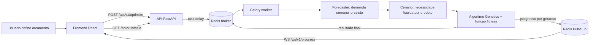

# INDEX — Base de Contexto (RAG) do Projeto

**Sistema:** Gestão Preditiva de Estoque com IA — previsão de demanda (ML clássico) + otimização de compras sob restrição orçamentária (Algoritmo Genético).
**Projeto acadêmico:** Projeto Integrador IV — Gestão de TI com Ênfase em IA.
**Público desta base:** agentes de IA e desenvolvedores que vão **implementar** o sistema a partir destes documentos.

---

## 1. Como usar esta base

1. **Leia sempre primeiro:** este `INDEX.md` + `02-padroes-de-engenharia/` (as regras não-negociáveis de código).
2. **Antes de escrever qualquer regra de negócio:** leia o documento correspondente em `01-dominio-e-negocio/`.
3. **Antes de criar arquivos:** leia `03-implementacao/01-estrutura-de-diretorios.md` — a estrutura é fixa, não invente pastas.
4. **Para executar:** pegue **uma** TASK de `04-decisoes-e-roadmap/03-tasks-de-implementacao.md`, leia só os documentos que ela lista em *Ler antes*, entregue e pare.
5. **Em caso de conflito entre documentos:** vale a ordem de precedência da seção 4 deste índice.
6. **Nunca invente regra de negócio.** Se um número, fórmula ou limiar não estiver nesta base, pare e pergunte. A fonte da verdade do negócio é o notebook `Projeto_Preditivo.ipynb` (Entregáveis 02, 03 e 04), já destilado aqui.

> Cada documento tem um cabeçalho YAML com `id`, `palavras-chave` e `fonte-da-verdade`. Cada documento é **autocontido**: repete os fatos essenciais em vez de só referenciar outros, para funcionar bem como chunk isolado de RAG.

---

## 2. Mapa dos documentos

### `00-arquitetura-tecnica/` — *arquitetura e stack (pré-existente, fonte da verdade de infraestrutura)*

| Arquivo | Para que serve | Leia quando |
|---|---|---|
| `vis_o_geral_da_arquitetura.md` | Propósito, padrão arquitetural, stack, fluxo de dados | Sempre, no onboarding |
| `especifica_es_do_backend.md` | FastAPI, Celery, Redis, WebSockets | Implementar qualquer parte do backend |
| `especifica_es_do_frontend.md` | React, Vite, TanStack Query, Plotly, Tailwind | Implementar o frontend |
| `contratos_de_api.md` | Payloads REST e mensagens WebSocket | Tocar em qualquer fronteira HTTP/WS |
| `infraestrutura_docker.md` | Serviços do Docker Compose e rede | Mexer em containers |

### `01-dominio-e-negocio/` — *o que o sistema calcula*

| Arquivo | Para que serve | Leia quando |
|---|---|---|
| `01-glossario-e-linguagem-ubiqua.md` | Termos PT-BR ↔ identificadores em inglês no código | Nomear qualquer classe, variável ou campo |
| `02-regras-de-negocio.md` | Ciclo de reposição, necessidade líquida, classificação de risco | Implementar domínio ou casos de uso |
| `03-previsao-de-demanda.md` | Features, modelo de regressão, MAE, geração do dataset | Implementar o módulo de forecasting |
| `04-funcao-fitness.md` | **Função de aptidão, operador de reparo, pesos, casos de borda** | Implementar ou alterar o fitness |
| `05-algoritmo-genetico.md` | **Cromossomo, população, seleção, crossover, mutação, elitismo** | Implementar o motor evolutivo |
| `06-baseline-e-indicadores.md` | Solução ingênua, KPIs e **valores-ouro para testes** | Escrever testes ou validar resultados |

### `02-padroes-de-engenharia/` — *como o código deve ser escrito (não-negociável)*

| Arquivo | Para que serve | Leia quando |
|---|---|---|
| `01-solid.md` | Os 5 princípios aplicados a este domínio, com exemplos | Sempre, antes de codar |
| `02-object-calisthenics.md` | As 9 regras adaptadas a Python, com o que é proibido | Sempre, antes de codar |
| `03-modularidade-e-fronteiras.md` | Camadas, regra de dependência, o que cada módulo pode importar | Criar arquivo novo ou import novo |
| `04-estrategia-de-testes.md` | Pirâmide de testes, determinismo, testes de valor-ouro | Escrever testes |

### `03-implementacao/` — *onde cada coisa mora*

| Arquivo | Para que serve | Leia quando |
|---|---|---|
| `01-estrutura-de-diretorios.md` | Árvore de pastas completa e obrigatória | Antes de criar qualquer arquivo |
| `02-contratos-de-codigo-backend.md` | Assinatura de cada classe, porta e caso de uso do backend | Implementar backend |
| `03-contratos-de-codigo-frontend.md` | Tipos, hooks, componentes e gráficos do frontend | Implementar frontend |
| `04-docker-e-infraestrutura.md` | Dockerfiles, compose, variáveis de ambiente, healthchecks | Containerizar ou subir o ambiente |

### `04-decisoes-e-roadmap/` — *decisões tomadas e ordem de execução*

| Arquivo | Para que serve | Leia quando |
|---|---|---|
| `01-divergencias-e-decisoes.md` | Divergências entre notebook/arquitetura e as decisões que as resolvem | Encontrar contradição entre documentos |
| `02-roadmap-de-implantacao.md` | Fases, tarefas atômicas e critérios de aceite por tarefa | Planejar ou escolher a próxima tarefa |
| `03-tasks-de-implementacao.md` | **TASK 1 … TASK 41**: ordens de serviço autocontidas, em ordem de execução | Executar uma tarefa — é o ponto de partida de quem vai codar |
| `04-correcoes-pendentes.md` | **FIX 1 … FIX 16**: defeitos e pendências da auditoria de 14/10/2026, com evidência reproduzível | Corrigir a implementação existente — leia antes de qualquer refatoração |

---

## 3. Restrições não-negociáveis do projeto

Estas quatro exigências valem para **todo** o código produzido. Um entregável que as viole deve ser recusado em revisão.

| # | Exigência | Onde está detalhada | Critério objetivo de verificação |
|---|---|---|---|
| 1 | **SOLID** | `02-padroes-de-engenharia/01-solid.md` | Toda dependência externa (sklearn, numpy, Redis, Celery) é acessada por uma `Protocol` declarada no domínio; nenhuma classe de domínio importa biblioteca de infraestrutura |
| 2 | **Object Calisthenics** | `02-padroes-de-engenharia/02-object-calisthenics.md` | Sem primitivo cru atravessando fronteira de domínio; sem `else`; ≤ 2 atributos de instância por classe; ≤ 1 nível de indentação por método |
| 3 | **Docker (containerização)** | `03-implementacao/04-docker-e-infraestrutura.md` | `docker compose up` sobe os 4 serviços e a otimização roda ponta a ponta sem Python/Node instalados no host |
| 4 | **Modularidade** | `02-padroes-de-engenharia/03-modularidade-e-fronteiras.md` | A regra de dependência (`domain ← application ← infrastructure/interface`) é verificada automaticamente no CI (`import-linter`) |

---

## 4. Precedência em caso de conflito

Quando dois documentos discordarem, vale esta ordem (do mais forte para o mais fraco):

1. `04-decisoes-e-roadmap/01-divergencias-e-decisoes.md` — decisões explícitas já tomadas sobre conflitos conhecidos.
2. `01-dominio-e-negocio/` — a regra de negócio e os números do notebook.
3. `02-padroes-de-engenharia/` — as regras de código.
4. `00-arquitetura-tecnica/` — a arquitetura e a stack.
5. `03-implementacao/` — detalhes de layout, que são consequência dos anteriores.

Se o conflito **não** estiver registrado em `01-divergencias-e-decisoes.md`, pare, registre-o lá e pergunte ao time antes de escolher por conta própria.

---

## 5. Fluxo do sistema em uma tela

**Em uma frase:** histórico de estoque → demanda prevista por produto (regressão linear) → necessidade de reposição do ciclo de 4 semanas → plano de compra ótimo dentro do orçamento (AG maximizando a função fitness) → plano devolvido ao gestor com os indicadores comparados a uma solução ingênua.
