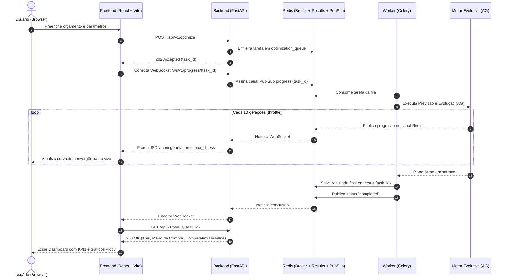

# Gestão Preditiva de Estoque com Inteligência Artificial

[](https://github.com/KMLegend/projeto-integrador-ia/actions/workflows/ci.yml)
[](https://www.python.org/)
[](https://nodejs.org/)
[](https://www.docker.com/)
[](.context/02-padroes-de-engenharia/02-object-calisthenics.md)

Plataforma acadêmica e aplicada de **otimização preditiva de reabastecimento de estoque**, combinando **Machine Learning (Regressão Linear para previsão de demanda semanal)** e **Computação Evolutiva (Algoritmo Genético multiobjetivo para alocação orçamentária)** sob restrições rígidas de capital de giro e mitigação de ruptura de estoque.

O projeto foi inteiramente construído com base em princípios rigorosos de engenharia de software: **Clean Architecture**, **SOLID**, **Object Calisthenics** (0 violações em domínio/aplicação), **fronteiras de modularidade estritas** (3 contratos verificados via `import-linter`) e **reprodutibilidade determinística** dos valores-ouro do notebook científico de referência.

---

## 🏗️ Arquitetura e Fluxo do Sistema

O sistema opera de forma assíncrona orientada a tarefas (Job-based) com acompanhamento em tempo real via WebSockets:



---

## 🚀 Como Executar

### Pré-requisitos
- **Docker** (versão 24+ recomendada)
- **Docker Compose** (versão 2+ recomendada)
- **GNU Make** (opcional, todos os comandos possuem equivalente docker compose)

Nenhum interpretador Python, Node.js ou banco de dados precisa estar instalado na máquina host.

### 1. Clonar e Iniciar
```bash
# Clone o repositório
git clone https://github.com/KMLegend/projeto-integrador-ia.git
cd projeto-integrador-ia

# Crie o arquivo de ambiente a partir do exemplo
cp .env.example .env

# Suba todos os serviços em modo de desenvolvimento (com hot reload)
make up
```

Após a inicialização dos containers:
- **Frontend SPA**: [http://localhost:5173](http://localhost:5173) (ou porta `3000` em produção via Nginx)
- **API Backend & Documentação Swagger**: [http://localhost:8000/docs](http://localhost:8000/docs)
- **Healthcheck da API**: [http://localhost:8000/health](http://localhost:8000/health)

### 2. Encerrar o Ambiente
```bash
# Derruba os containers e remove os volumes nomeados
make down
```

---

## 🧪 Suíte de Testes e Qualidade

O projeto implementa uma pirâmide de testes rígida e verificada por portões de qualidade automatizados:

```bash
# Executa testes unitários e de integração do backend
make test

# Executa os testes ponta a ponta no Docker Compose (10 critérios de containerização)
make e2e

# Executa lint, checagem de tipos (mypy strict) e verificação de contratos arquiteturais
make lint

# Executa a verificação estrita de Object Calisthenics (zero violações)
make calisthenics

# Executa verificação de cobertura (mínimo 95% no domínio e 80% global)
make test-domain-cov
make test-global-cov

# Executa linters e testes do frontend
make frontend-lint
make frontend-test

# Executa TODOS os portões de integração contínua (CI)
make ci
```

---

## 🤖 Pré-treinamento do Modelo de Previsão

O worker treina automaticamente o modelo de regressão linear sob demanda na primeira requisição e armazena o artefato em cache. Para realizar o pré-treinamento explicitamente:

```bash
make train
```

---

## ⚠️ Aviso sobre Dados Simulados (RN-09)

> **AVISO DE NATUREZA DIDÁTICA (RN-09):**  
> Os dados históricos de vendas e níveis de estoque utilizados nesta aplicação foram sintetizados com base na distribuição estatística de consumo e características típicas do varejo supermercadista brasileiro (SKUs como Leite UHT, Café torrado, Arroz tipo 1, Feijão carioca, Açúcar refinado e Óleo de soja).  
> A solução foi concebida para fins acadêmicos e validação do método híbrido (ML + AG). Para aplicação em ambiente de produção real, os dados devem ser integrados aos sistemas ERP/WMS da organização via implementação do adaptador da porta `StockHistoryRepository`.

---

## 📚 Documentação Técnica e Decisões de Projeto

Toda a fundamentação matemática, regras de negócio, contratos de dados e decisões arquiteturais estão detalhados na pasta [`.context/`](file:///.context/INDEX.md):

- [Visão Geral e Índice Contextual](.context/INDEX.md)
- [Regras de Negócio e Função Fitness](.context/01-dominio-e-negocio/02-regras-de-negocio.md)
- [Baseline Heurístico e Valores-Ouro](.context/01-dominio-e-negocio/06-baseline-e-indicadores.md)
- [Diretrizes de SOLID](.context/02-padroes-de-engenharia/01-solid.md)
- [Regras de Object Calisthenics e Justificativas](.context/02-padroes-de-engenharia/02-object-calisthenics.md)
- [Fronteiras de Modularidade e Import-Linter](.context/02-padroes-de-engenharia/03-modularidade-e-fronteiras.md)
- [Registro de Decisões Arquiteturais (D-01 a D-10)](.context/04-decisoes-e-roadmap/01-decisoes-arquiteturais.md)
